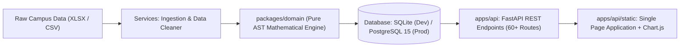

# CampusPulse: Student Success and Placement Readiness Platform

> Student analytics and advising platform for colleges and university departments.

## Positioning and purpose

Higher education institutions frequently have student data scattered across LMS logs, attendance rosters, coding assessment tools, and placement records. CampusPulse brings these signals together into a deterministic student success score and generates a prioritized advisor action list. This helps faculty advisors and department chairs identify struggling students and record interventions quickly.

### Non-goals

- Publicly ranking students or showing competitive leaderboards.
- Making irreversible decisions based on a single score or assessment.
- Comparing colleges against one another.
- Sharing student personally identifiable information beyond assigned advisors.
- Using opaque or non-deterministic language models to compute student scores.

## System architecture and technology stack



### Technology stack

- Backend framework: [FastAPI](https://fastapi.tiangolo.com/) (Python 3.11+) with async lifespan lifecycle management, Pydantic schemas, and `{ data, meta }` response envelopes.
- Frontend architecture: Single page application in vanilla HTML5, CSS, and modern JavaScript served directly by FastAPI at `/`.
- Data visualization: [Chart.js 4.4](https://www.chartjs.org/) for quadrant scatter plots, contribution breakdown charts, and metric trajectories over time.
- Domain engine: Pure Python mathematical scoring module (`packages/domain/`) with zero runtime network or LLM dependencies.
- Database and ORM: [SQLAlchemy 2.0](https://www.sqlalchemy.org/) with dual engine support:
  - Development and demo: Pre-seeded local SQLite (`campuspulse_local.db`).
  - Production: PostgreSQL 15+ via asyncpg connection pooling.
- Deployment platform: [Render](https://render.com) Web Service configured through `render.yaml` and `requirements.txt`.

## Student success score calculation

The composite success score ($S \in [0, 100]$) is computed deterministically from six indicators:

$$S = 0.25(I_{\text{acad}}) + 0.20(I_{\text{att}}) + 0.20(I_{\text{place}}) + 0.15(I_{\text{lms}}) + 0.10(I_{\text{eng}}) + 0.10(I_{\text{skills}})$$

### Indicator definitions

| Indicator | Weight | Formulation | Rationale |
| :--- | :---: | :--- | :--- |
| Academic ($I_{\text{acad}}$) | 25% | $\text{clamp}(\text{CGPA} \times 10 - 3 \times \min(\text{backlogs}, 5), 0, 100)$ | Academic baseline penalized for active backlogs. |
| Attendance ($I_{\text{att}}$) | 20% | $\text{clamp}(\mu_{\text{att}} - 5 \times N_{\text{sub} < 60\%}, 0, 100)$ | Penalizes subject-level absenteeism even if average attendance is acceptable. |
| Placement ($I_{\text{place}}$) | 20% | $0.35 \cdot \text{Aptitude} + 0.40 \cdot \text{Coding} + 0.25 \cdot \text{MockInterview}$ | Placement readiness indicator. Uses general assessment sub-score when coding logs are absent. |
| LMS Engagement ($I_{\text{lms}}$) | 15% | $0.50 \cdot \text{CompletionPct} + 0.50 \cdot \text{ScaledLogins}$ | Measures regular participation in course portal tasks. |
| Campus Engagement ($I_{\text{eng}}$) | 10% | $\text{clamp}\left(\frac{\text{WinsorizedSum}(\text{events}, \text{clubs}, \text{hackathons}, \text{certs})}{20} \times 100, 0, 100\right)$ | Extracurricular activities, winsorized at the 95th percentile to limit extreme outlier skew. |
| Skills Profile ($I_{\text{skills}}$) | 10% | $0.60 \cdot \text{TechnicalAssessment} + 0.40 \cdot \text{SoftSkills}$ | Technical competency and interpersonal evaluation. |

Weights strictly sum to 1.0, verified at startup by `scripts/boot_check.py`.

## Safety floors, configurable thresholds, and tier rules

CampusPulse implements a two-tier safety architecture distinguishing between institutional policy alerts and emergency hard-floor circuit breakers:

### 1. Two-Tier Alert & Safety Floor Framework

| Threshold Level | Metric Target | Institutional Policy & Pedagogical Purpose | Operational Behavior |
| :--- | :---: | :--- | :--- |
| **Configurable Standard Alert** | $\text{Attendance} < 75.0\%$ | Statutory UGC/AICTE exam eligibility threshold. Configurable by institution (`/api/v1/config/thresholds`). | Flags student for advisory check-in, mentoring contact, and recovery planning. |
| **Academic Warning Alert** | $\text{CGPA} < 6.0$ | Standard academic probation benchmark. | Triggers academic mentoring and tutoring clinic recommendation. |
| **Backlog Warning Alert** | $\text{Backlogs} \ge 2$ | Course progression alert. | Reviews course registration and exam preparation plan. |
| **Emergency Hard-Floor** | $\text{Attendance} < 57.0\%$ | Mathematical point-of-no-return for statutory exam eligibility. Safety circuit breaker. | Immediately overrides tier to **Priority Support [PINNED]**; pins student to top of advisor triage queue. |
| **CGPA Emergency Hard-Floor** | $\text{CGPA} < 4.7$ | Semester progression stall limit. | Overrides tier to **Priority Support [PINNED]**. |
| **Backlog Emergency Hard-Floor**| $\text{Backlogs} \ge 3$ | Imminent academic disqualification trigger. | Overrides tier to **Priority Support [PINNED]**. |

### 2. Mathematical Derivation of the 57% Emergency Hard Floor

*Why 57% attendance rather than a routine warning at 75%?*

The 57.0% attendance trigger is a safety circuit-breaker derived from academic calendar mathematics:
- In a standard Indian university semester of 15 instructional weeks (approx. 75 instructional days), mid-semester reviews occur at **Week 9** (60% completion, $t_1 = 0.60$), leaving 6 weeks (40% remaining, $t_2 = 0.40$).
- A student at 57.0% attendance at Week 9 has accumulated:
  $$0.60 \times 57.0\% = 34.2\% \text{ of semester total}$$
- Even if that student achieves **100.0% perfect attendance** for every remaining lecture through Week 15:
  $$\text{Max Attainable Final Attendance} = 34.2\% + (0.40 \times 100.0\%) = 74.2\%$$
- Because $74.2\% < 75.0\%$, achieving the statutory 75.0% UGC/AICTE exam eligibility threshold without formal administrative condonation is **mathematically impossible**.
- Therefore, below 57%, routine coaching cannot mathematically salvage eligibility; the student is pinned to `Priority Support` for emergency administrative intervention, medical/hardship documentation reviews, or formal condonation petitions.

### 3. Configurable Alert Thresholds API

Colleges can customize standard alerts and emergency floors via the API:
- `GET /api/v1/config/thresholds`: Returns active alert thresholds, policy defaults, and derivation text.
- `PUT /api/v1/config/thresholds`: Updates runtime thresholds with validation enforcing $\text{attendance\_emergency\_min} < \text{attendance\_standard\_min}$ and $\text{cgpa\_emergency\_min} < \text{cgpa\_warning\_min}$.
- `POST /api/v1/config/thresholds/reset`: Restores statutory UGC/AICTE defaults.

### 4. Safety Floors and Tier Precedence

To keep high-risk students visible even when they score well on other dimensions, tier classification evaluates safety floors before score bands:

1. Hard floor trigger:
   $$\text{Attendance} < 57.0\% \quad \lor \quad \text{CGPA} < 4.7 \quad \lor \quad \text{Backlogs} \ge 3 \implies \mathbf{Priority\ Support\ [PINNED]}$$
   Students triggering a hard floor are pinned to the top of the advisor action list.
2. Review band:
   $$57.0\% \le \text{Attendance} \le 63.0\% \quad \lor \quad 4.7 \le \text{CGPA} \le 5.3 \implies \mathbf{Review}$$
3. Standard score bands:
   - On Track: $\text{Score} \ge 60$
   - Watchlist: $40 \le \text{Score} < 60$
   - Priority Support: $\text{Score} < 40$

## Student segmentation

Students are classified into five mutually exclusive segments to suggest relevant support strategies:

1. Struggling on All Fronts: Tier is `priority_support` with 4 or more sub-indices below the cohort 25th percentile ($p_{25}$).
2. Academic Stars with Placement Gap: Strong academic score ($I_{\text{acad}} \ge 75$) alongside lower placement readiness ($I_{\text{place}} \le p_{25}$).
3. Hustlers at Academic Risk: High extracurricular activity ($I_{\text{eng}} \ge 75$) but academic index falling below the cohort quartile ($I_{\text{acad}} < p_{25}$).
4. Quietly Disengaged: Acceptable attendance ($I_{\text{att}} \ge 60\%$) paired with low LMS and campus participation ($I_{\text{lms}}, I_{\text{eng}} < p_{25}$).
5. Balanced Performers: Steady progress across all evaluated areas.

## Score breakdown and simulation

- Point attribution: Every student record details the positive points gained and negative penalties incurred by each indicator (such as $+18.2$ from Academics or $-6.0$ from Backlog Penalty).
- What-if simulation (`POST /api/v1/what-if`): Faculty advisors can project potential score changes in memory (for instance, the effect of raising attendance from 58% to 75% or improving a coding score by 15 points) without altering persistent database records.

## Intervention workflow

1. Detection: The system flags risk indicators and hard-floor triggers.
2. Prioritization: The advisor action list ranks students by urgency, actionability, and recent trajectory.
3. Assignment: Advisors log specific steps (such as a coding clinic, attendance check-in, or mentoring session) with target dates and notes.
4. Follow-up: Status tracks progress (`OPEN` -> `IN_PROGRESS` -> `COMPLETED`) to evaluate whether the student's metrics improve.

## Machine learning governance (G1-G8)

### Role of machine learning (Optional Audited Fairness Proxy)

The core student success scoring engine is 100% deterministic and explainable, utilizing pure AST arithmetic formulas in `packages/domain/scores.py`. Generative models and stochastic classifiers do not compute or alter student scores, tiers, or priority rankings.

Machine learning operates strictly as an **optional, audited fairness proxy add-on**:
- Model registry (`/api/v1/ml/models`): Baselines (Random Forest, Gradient Boosting, Logistic Regression) trained to detect non-linear risk patterns offline.
- Feature importance (`/api/v1/ml/feature-importance`): Evaluates domain indicator importance against historical holdout data.
- Demographic parity & fairness audit (`/api/v1/ml/evaluation`): Audits demographic parity and cross-cohort bias without using protected attributes.
- Disagreement detector (`/api/v1/ml/agreement-check`): Detects when statistical proxy models diverge from deterministic rules to append advisory review notes (`confidence_note`).
- Guardrails G1-G8: Strict programmatic enforcement. Machine learning proxy outputs never override deterministic scores, safety floors, or tier assignments.

## Local setup

### 1. Prerequisites

- Python 3.11+
- SQLite (included) or PostgreSQL 15+

### 2. Environment configuration

```bash
# Clone repository
git clone https://github.com/bhavyaanand2101-coder/BYTEXL_HACKATHON_2026_OCT.git
cd BYTEXL_HACKATHON_2026_OCT

# Copy environment configuration
cp .env.example .env
```

### 3. Install dependencies

```bash
pip install -r requirements.txt
```

### 4. Run pre-flight validation

```bash
python scripts/boot_check.py
```

### 5. Run test suite

```bash
pytest
```

### 6. Start the application server

```bash
uvicorn apps.api.main:app --reload --host 0.0.0.0 --port 8000
```

Open `http://localhost:8000` in your browser to view the application interface, advisor queue, and student views.

## Testing

The test suite verifies arithmetic determinism, API schemas, and privacy controls:

```bash
pytest -v
```

### Test coverage areas

- `tests/unit/test_boot_check.py`: Verifies weight summation ($1.0000000000$) and configuration file integrity.
- `tests/unit/test_determinism.py`: Confirms identical inputs yield identical outputs.
- `tests/unit/test_ai_execution_contract.py`: Scans AST to prevent runtime model imports in scoring modules.
- `tests/api/test_pii_scope.py`: Confirms metric endpoints omit names and student roll numbers.
- `tests/api/test_interventions.py`: Tests the full intervention lifecycle (create, update, list).

## Deployment on Render

The repository includes a deployment configuration in `render.yaml`:

```yaml
services:
  - type: web
    name: campuspulse
    runtime: python
    buildCommand: pip install -r requirements.txt
    startCommand: uvicorn apps.api.main:app --host 0.0.0.0 --port $PORT
    envVars:
      - key: PYTHON_VERSION
        value: 3.11.9
      - key: DATABASE_URL
        value: sqlite:///./campuspulse_local.db
      - key: ENVIRONMENT
        value: production
```

## Safeguards and limitations

- Support focus: Risk indicators are signals for advisor coaching, not punitive measures.
- Transparent attribution: Recommendations cite specific indicators rather than automated decisions.
- Collegiate scope: Evaluates campus engagement and readiness indicators within academic programs; does not project lifetime career outcomes.
- Privacy boundaries: Sensitive demographic attributes (such as socio-economic status, caste, religion, or gender) are excluded from ingestion.
